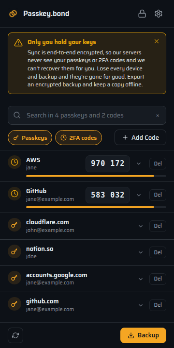
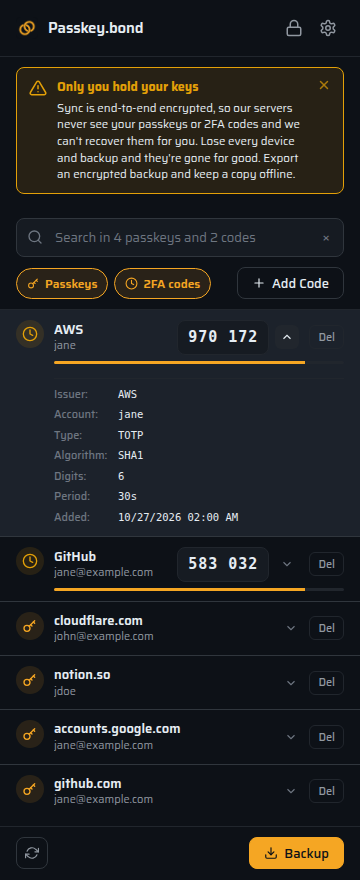
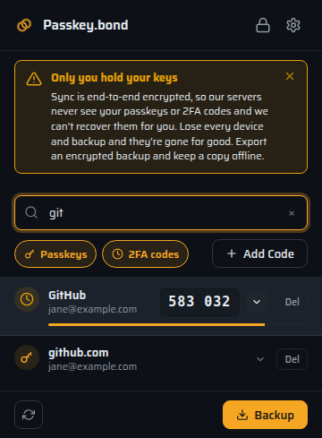
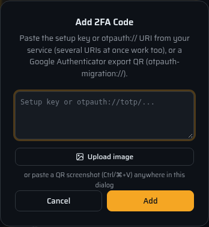
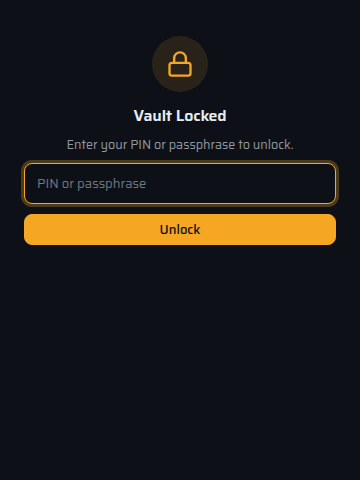

# Passkey.bond

Keeps your passkeys and 2FA codes on your own devices. Passkey.bond intercepts WebAuthn API calls and stores passkeys locally, bypassing the browser's native passkey UI. It runs as a browser extension for Chromium browsers and Firefox, and as an Android passkey provider app; an iOS app is in progress.

Website: <https://passkey.bond>

## Download

| Platform | Status |
| --- | --- |
| **Chrome** · **Edge** · **Brave** · **Opera** | Not yet published — [build from source](#build-from-source) |
| **Firefox** | Not yet published — [build from source](#build-from-source) |
| **Android** | Not yet published — see [android/README.md](android/README.md) |

Store links will be listed at <https://passkey.bond/download> once they exist.

> Found a bug? [Open an issue](https://github.com/colinmollenhour/passkey-bond/issues).

> Passkey.bond began as a fork of [Fenko Vault](https://github.com/FenkoHQ/passkey-vault) by Fenko, MIT licensed. It can import Fenko Vault backups and join a Fenko Vault sync chain, so you can move an existing vault across.

---

## Screenshots

<table>
  <tr>
    <td align="center" valign="top" width="33%">
      
    </td>
    <td align="center" valign="top" width="33%">
      
    </td>
    <td align="center" valign="top" width="33%">
      
    </td>
  </tr>
  <tr>
    <td align="center"><sub><b>One searchable vault</b></sub></td>
    <td align="center"><sub><b>Details on every entry</b></sub></td>
    <td align="center"><sub><b>Find anything fast</b></sub></td>
  </tr>
  <tr>
    <td align="center" valign="top">
      
    </td>
    <td align="center" valign="top">
      
    </td>
    <td></td>
  </tr>
  <tr>
    <td align="center"><sub><b>Add codes by URI or QR image</b></sub></td>
    <td align="center"><sub><b>Lock behind a PIN</b></sub></td>
    <td></td>
  </tr>
</table>

---

## Features

- **WebAuthn interception** — captures `navigator.credentials.create()` and `navigator.credentials.get()` before the browser handles them
- **Local storage** — passkeys stay in browser local storage, no external server
- **TOTP / 2FA codes** — built-in RFC 6238 / 4226 authenticator with live codes, clipboard copy, and `otpauth://` import (paste a URI, paste a QR screenshot, or upload a QR image — decoded locally, no camera)
- **Unified vault** — passkeys and 2FA codes share one searchable list with per-type filters; each entry expands to show its details
- **Vault lock** — an optional PIN or passphrase encrypts the vault at rest and locks the popup; set, change, or remove it any time
- **Backup & import** — export all passkeys (including private keys) and TOTP entries as a password-encrypted JSON file, import on another device or the mobile app
- **Move in from anywhere** — import passkeys and MFA seeds from CXF, Bitwarden, Proton Pass, Dashlane, 1Password, KeePassXC, LastPass, Keeper, Google Authenticator, Aegis, 2FAS, andOTP, FreeOTP+, Raivo and Ente Auth; export back out as CXF, `otpauth://` or CSV — Options → Import & Export ([details](docs/porting/README.md))
- **Cross-device sync** — optional Nostr-based sync chain using a BIP-39 seed phrase; passkeys and 2FA codes sync end-to-end encrypted
- **Emergency access** — standalone recovery page for vault management without the extension popup
- **Chrome, Firefox & Android** — one codebase; browser extension plus a native Android passkey provider

---

## Installation

Passkey.bond isn't in any store yet. Build it from source:

### Build from source

Requires Node.js 18+.

```bash
git clone https://github.com/colinmollenhour/passkey-bond.git
cd passkey-bond
npm install

npm run build          # Chrome
npm run build:firefox  # Firefox
npm run build:all      # Both
```

**Load in Chrome:**

1. Open `chrome://extensions/`
2. Enable Developer mode
3. Click "Load unpacked" → select `dist/`

A development build shows its commit as its version, such as `0.12.0+2d873fb`, on `chrome://extensions` and in the options page.

Every development build has the extension ID `odoehegfpkpmhicjkpdajlpdhcaghkhi`, whichever folder it is loaded from, so the vault carries over to a newer build. To update, load the new folder the same way, or replace the files in the loaded folder and click the reload icon. **Remove** deletes the vault.

**Load in Firefox:**

1. Open `about:debugging#/runtime/this-firefox`
2. Click "Load Temporary Add-on..."
3. Select `dist-firefox/manifest.json`

---

## How it works

1. A content script injects into every page and overrides the native WebAuthn API
2. On `credentials.create()`, the background script generates an ECDSA P-256 key pair, creates a valid attestation response, and stores the passkey
3. On `credentials.get()`, it signs the challenge with the stored private key using proper CBOR encoding
4. The popup reads directly from `chrome.storage.local` — no background message passing for display
5. TOTP codes are derived locally from each entry's secret using HMAC-SHA1/256/512; the popup caches the current code and refreshes it once per second while the vault is open
6. With a PIN or passphrase set, the vault moves into AES-256-GCM encrypted storage under a key derived with scrypt (N=2^17, r=8, p=1), and the popup gates behind a lock screen; removing it moves the vault back to cleartext. Vaults locked by older versions are re-keyed to scrypt on their next unlock

---

## How sync works

Cross-device sync is optional and off by default. When you enable it, your devices exchange end-to-end encrypted messages over [Nostr](https://github.com/nostr-protocol/nips) relays — there is no Passkey.bond account, no server that holds a readable vault, and nothing a relay operator can read, including us.

**Setup.** Enabling sync generates a BIP-39 seed phrase (the "sync chain"). You type that phrase into your other devices; every device holding the phrase is on the chain. The phrase never leaves your devices.

**Key derivation.** Each device hashes the phrase (SHA-256) and runs that through scrypt (N=2^17, r=8, p=1: 128 MiB), then HKDF-SHA256 splits the result into three: the chain ID that relays see, an AES-256-GCM key for encrypting sync payloads, and a secp256k1 keypair for signing Nostr events. Different chains derive different keys, and checking a guessed phrase against a chain ID seen on a relay costs a full scrypt. The exact construction is in [`src/sync/chain-keys.ts`](src/sync/chain-keys.ts), pinned by test vectors in [`tests/sync/chain-keys.test.ts`](tests/sync/chain-keys.test.ts).

**Transport.** Sync messages are standard Nostr events (NIP-01): kind `30078` (application data) with a `d` tag of `pksync-v5-<chainId>`, signed with BIP340 Schnorr signatures. The event content is AES-GCM ciphertext. A relay — or anyone watching one — sees ciphertext, the chain tag, and event timing. Passkey IDs, relying-party domains, device names, and counts of what you store are all inside the encrypted payload.

**What gets synced.** Passkeys (including private keys — that's the point of sync) and TOTP entries. Merging is additive: a device adds entries it doesn't have and updates ones with a newer creation time. Sync never deletes local data.

**Receiving.** Devices verify each event's Schnorr signature and ID hash before decrypting, ignore replayed event IDs, and discard anything that doesn't decrypt with the chain key.

**Relays.** Events are published to all configured relays and subscriptions run on all of them, so two devices sync if they share at least one working relay. The defaults:

| Relay | Operator |
| --- | --- |
| `wss://relay.passkey.bond` | Passkey.bond. Accepts only Passkey.bond sync events ([`relay/`](relay/)). |
| `wss://relay.damus.io` | Damus |
| `wss://nos.lol` | nos.lol |

You can add or remove relays in the extension options. The sync protocol is the same as Fenko Vault's, so Passkey.bond and Fenko Vault devices on one chain sync with each other as long as they share a relay.

---

## Project structure

```
src/
├── background/         # Service worker / background script
├── content/            # Content script + WebAuthn injection
├── crypto/             # BIP-39, ECDSA, AES-GCM, secure storage
├── porting/            # Import/export for other providers' formats (CXF, CSV, vendor JSON)
├── sync/               # Nostr-based sync service
├── ui/                 # popup, options, import, sync-setup, sync-settings, emergency
├── manifest.json       # Chrome MV3
└── manifest.firefox.json
```

---

## Security

- Passkeys and TOTP secrets live in `chrome.storage.local`. Without a PIN or passphrase they are in cleartext. With one they are encrypted, but anyone with a copy of the browser profile can try every 6-digit PIN within hours on a GPU, however slow the key derivation; a short PIN mainly protects against someone at the unlocked computer. Use a passphrase of four or more random words, or a PIN of 10+ digits, and treat the profile as sensitive regardless
- Export files contain private keys and TOTP secrets — treat them like passwords. The CXF, otpauth:// and CSV exports are plaintext because the receiving app expects that; delete them once imported. The popup's password-protected backup is the one to keep
- Sync payloads are end-to-end encrypted; relays never see plaintext (see [How sync works](#how-sync-works))
- Anyone who obtains your sync seed phrase can join your chain and receive your vault — protect it like the vault itself
- This is a research/developer tool, not a production credential manager

---

## License

MIT. See [LICENSE](LICENSE). Passkey.bond is © Colin Mollenhour and contains code from Fenko Vault, © Fenko, under the same license.
