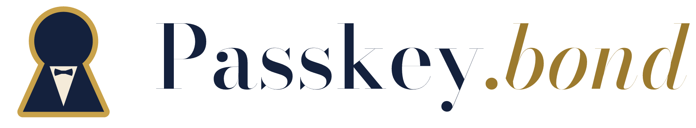
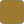

# Passkey.bond brand



**The idea:** a keyhole, and in it a man in black tie. The keyhole stands for
the vault. The dinner jacket stands for the agent who keeps its secrets: a
British operative from late-1970s spy cinema, all Riviera casinos and quiet
confidence. The name is the same joke told twice: *passkey* plus *bond*.

## Look and feel

| It is | It isn't |
| --- | --- |
| Suave, understated, a little dangerous | Loud, techy, neon, "hacker" |
| Black tie: navy, ivory, a glint of gold | Gradients, glows, glassmorphism |
| Late 70s: Didone titles, geometric sans, wide tracking | Retro pastiche: wood panelling, film grain, VHS effects |
| Dry British wit, used sparingly | Jokes in error messages, exclamation marks |
| One confident mark, lots of space | Busy badges, crests, shields |

Mood references: a dinner jacket at a Monte Carlo baccarat table, a brass
key on a hotel fob, smoked glass, a vintage Lotus in navy. The brand evokes
the era through shape, colour and attitude, never through borrowed symbols.

**Never use** the 007 gun logo, the gun-barrel motif, the number 007, guns,
or any film's title, typography or imagery. They are trademarks, and the
keyhole doesn't need them.

## Colour

| Swatch | Name | Hex | Role |
| --- | --- | --- | --- |
|  | Midnight navy | `#14213D` | The keyhole and jacket. Primary dark surface and text on light. |
|  | Tuxedo black | `#111111` | Dark-mode background, app icon tile. |
|  | Brushed gold | `#C9A24A` | The rim. Accents, focus rings and highlights on dark. |
|  | Deep gold | `#9C7A2E` | Gold on light backgrounds (the ".bond" in the light lockup). |
|  | Ivory | `#F4EBD9` | The shirt front. Light surfaces, text on dark. |
|  | Oxblood | `#6B1E2A` | Sparing accent: destructive actions, warnings. |
|  | Racing green | `#0F3D2E` | Secondary accent: success, "verified". |

Contrast (WCAG ratio):

- Navy on ivory: 13.5. Ivory on black: 15.9. Use these pairs for body text.
- Gold on black: 7.9. Gold on navy: 6.7. Gold works for text on dark backgrounds.
- Deep gold on white: 4.0. Use it only for large text (24 px and up), never body copy.
- Gold on white: 2.4. Never use it for text on light backgrounds.
- Navy on Chrome's dark toolbar (`#35363A`): 1.3, which is why the mark has a gold rim (5.0 against the same toolbar).

## Typography

| Use | Typeface | Notes |
| --- | --- | --- |
| Wordmark, titles | [Bodoni Moda](https://fonts.google.com/specimen/Bodoni+Moda) 500, optical size 96 | High-contrast Didone, the late-70s luxury title face. Titles only; it gets brittle below 18 px. ".bond" is set in the italic. |
| Interface, body | [Jost](https://fonts.google.com/specimen/Jost) 400/500 | A geometric sans in the Futura mould, the other half of the 70s look. |
| Labels, eyebrows | Jost 500, uppercase, `letter-spacing: 0.14em` | Title-card tracking. Short labels only. |

Both are SIL Open Font License fonts from Google Fonts, so they can be bundled
in the extension and the apps. The logo files don't need them: the wordmark is
converted to outlines.

## Voice

Calm, brief, dry. The product guards people's logins, so clarity always comes
first, and wit is only seasoning.

- Success and empty states may wink: "Passkey saved. Discreetly." "No passkeys yet. The vault awaits."
- Errors and security warnings are plain and exact, never playful: "Wrong passphrase. 2 attempts left before a 5-minute lockout."
- British spelling (colour, authorise), no exclamation marks, no "Oops".
- Leave spy jargon out of instructions. "Back up your vault", not "Secure the dossier".

## The logo

### Files

| File | Use it for |
| --- | --- |
| [`passkey-bond-mark.svg`](passkey-bond-mark.svg) | The primary mark, full colour. 64 px and up. |
| [`passkey-bond-mark-32.svg`](passkey-bond-mark-32.svg) | Drawn for 24–64 px: heavier rim, bigger shirt front and bow tie. |
| [`passkey-bond-mark-16.svg`](passkey-bond-mark-16.svg) | Drawn for 16–20 px: heaviest rim, no bow tie (it can't survive at that size). |
| [`passkey-bond-mark-black.svg`](passkey-bond-mark-black.svg), [`-white`](passkey-bond-mark-white.svg), [`-gold`](passkey-bond-mark-gold.svg) | One-colour mark (silhouette with the shirt front cut out). Print, embossing, single-colour UI, photos. |
| [`passkey-bond-mark-mono-16.svg`](passkey-bond-mark-mono-16.svg) | One-colour 16 px drawing, for monochrome status bars and favicons. |
| [`passkey-bond-icon.svg`](passkey-bond-icon.svg) | App icon: the mark on a tuxedo-black rounded tile. Store listings, home screens. |
| [`passkey-bond-icon-light.svg`](passkey-bond-icon-light.svg) | App icon on an ivory tile, for light contexts. |
| [`passkey-bond-lockup.svg`](passkey-bond-lockup.svg) / [`-reversed`](passkey-bond-lockup-reversed.svg) | Mark plus wordmark, for light / dark backgrounds. |
| [`passkey-bond-wordmark.svg`](passkey-bond-wordmark.svg) / [`-reversed`](passkey-bond-wordmark-reversed.svg) | Wordmark alone, for when the mark is already nearby. |
| [`passkey-bond-logo.png`](passkey-bond-logo.png) | 512 px raster of the primary mark, used by `scripts/capture-promo-video.js`. |

PNG exports live in [`png/`](png):

- `png/mark/`: the mark at 16–1024 px, each size from the right drawing.
- `png/extension/`: `icon16/32/48/128.png`, drop-in replacements for `src/icons/`.
- `png/icon/`: app icon tiles at 48, 128, 180 (iOS), 192 and 512 (Android), and 1024 (stores).
- `png/lockup/`: lockups and wordmarks at 1× and 2×.

### Sizes

The mark comes in three drawings, not one drawing scaled down. Pick by
rendered pixel size:

| Rendered size | Drawing |
| --- | --- |
| 16–20 px (browser toolbar at 1×, favicons) | `-16` |
| 24–64 px (toolbar at 2×, extensions page, lists) | `-32` |
| 64 px and up | the primary mark |

The lockup needs at least 24 px of height. Below that, use the mark alone.

### Light and dark

The full-colour mark works on any background: the gold rim carries it on
dark, and the navy body carries it on light. It was checked at real pixel
sizes on Chrome's light, tinted-light, dark and pure-black toolbars. Use the
one-colour versions only where full colour isn't available, or to sit quietly
on a photo.

### Clear space and don'ts

- Keep clear space around the mark of at least a quarter of its width.
- Don't put the full-colour mark on a navy background, where the body would melt into it. Use the gold one-colour mark or the black app tile instead.
- Don't recolour the parts, except by using the one-colour files. The rim is always gold, the shirt front always ivory.
- Don't stretch it, rotate it, outline it, or add shadows, bevels or gradients.
- Don't put the bow tie back on the 16 px drawing, and don't scale the primary mark down to toolbar size.
- Don't pair the mark with guns, "007" or film imagery (see above).

## Regenerating the assets

Every file here is generated from parameters in [`tools/build.mjs`](tools/build.mjs):
the keyhole circle, the neck angle, the rim width, and the shirt-front and
bow-tie sizes for each drawing. To change the logo, edit those numbers and
rebuild:

```sh
cd docs/brand/tools
npm ci
npm run build
```

The build downloads the two fonts into `tools/.fonts/` on first run (git
ignores that folder). It rewrites every SVG and PNG in `docs/brand/`, and it
also refreshes the AAGUID icons (`docs/aaguid/vault-icon.svg` and
`vault-icon-tiny-ps.svg`) and the two logo fields in
`docs/aaguid/mds-statement.json`.

The design began as option A1 (a Codex image-generation sketch) from a
15-option review across Codex, Gemini and Grok, and was then redrawn by hand
as vectors.

## Rollout status

The brand assets are ready, but the apps don't use them yet:

- [ ] Extension icons: copy `png/extension/icon16/48/128.png` into `src/icons/` (the manifest also accepts a 32).
- [ ] Android launcher icons (`android/app/src/main/res/mipmap-*`) and Play listing icon (`android/play/icon-512.png`).
- [ ] iOS app icon.
- [ ] Interface colours: the popup, options, vault dialog, emergency UI and the Android web UI still use the old amber `#F5A623` on charcoal `#0D1117`.
- [ ] Promo video styling in `scripts/capture-promo-video.js` (amber, Saira) and the Chrome Web Store banner (prompt in `docs/cws/promo-assets.md`).
- [ ] FIDO Metadata Service listing (the statement is ready in `docs/aaguid/`).
